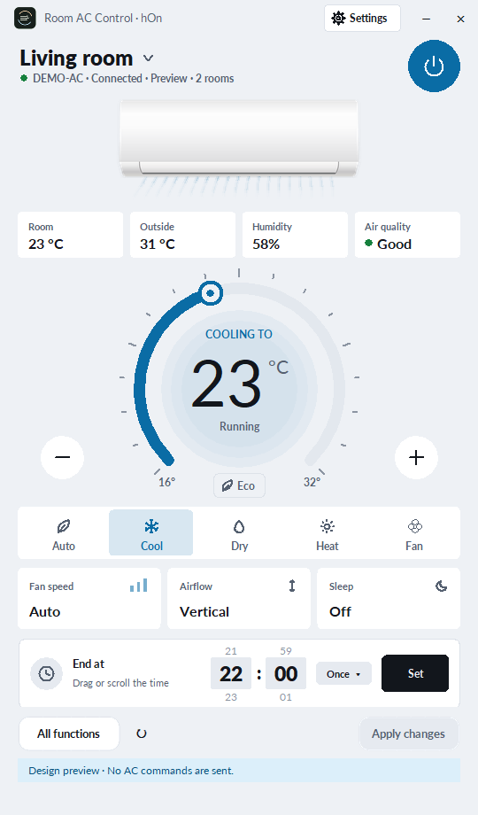
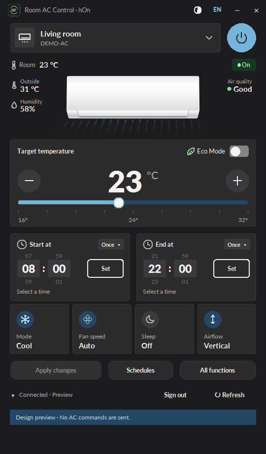

# Room AC Control for hOn

A Windows desktop controller for air conditioners connected to **hOn accounts**, including supported Haier units. Set your room temperature, switch modes, run comfort presets, and keep the latest AC status on your computer.

An independent community project powered by [pyhOn](https://github.com/Andre0512/pyhOn). It is not affiliated with, sponsored by or endorsed by Haier or hOn. Those names identify compatibility only; this project uses its own icon and generic appliance illustration.

<p>
  
  
</p>

## Start in one click

**Install it — Python is included, no administrator rights needed.**

1. Download **Room-AC-Control-for-hOn-<version>-Windows-x64-Setup.exe** (or the `.msi`, if you prefer Windows Installer) from [Releases](https://github.com/LuisBadal0/room-ac-control-hon/releases/latest).
2. Run it and click **Install**. It installs for your Windows user only, in `%LOCALAPPDATA%\Programs\Room AC Control`, and adds **Room AC Control** to the Start menu. Leave **Create a desktop shortcut** ticked to add one to the desktop too.
3. Sign in with the same hOn email and password you use on your phone.

Uninstall from **Settings › Apps › Installed apps**. Your remembered sign-in and settings stay in your Windows profile. The installers are not code-signed yet, so Windows SmartScreen may ask you to confirm (**More info › Run anyway**).

**Or use the portable release.**

1. Download the Windows x64 ZIP from [Releases](https://github.com/LuisBadal0/room-ac-control-hon/releases/latest).
2. Extract the entire ZIP into a folder.
3. Double-click **Start Room AC Control.cmd** in the main folder.
4. Sign in with the same hOn email and password you use on your phone.

Keep the `runtime/` folder next to the launcher: it contains the application, Python, libraries, artwork and dependency notices. You can move the extracted folder to another location. Remembered accounts remain encrypted in your Windows profile.

**Running a source checkout:** install Python 3.11 or newer with Tkinter, then double-click the same launcher. First launch creates `.venv/` and installs dependencies there; internet access is needed for that setup. Python 3.13 is used for the portable build.

## What it does

- A dashboard built around a temperature dial: drag along the ring, click it, scroll on it or use −/+. Power, Eco, a mode bar, and Fan speed, Airflow and Sleep tiles sit around it. The accent colour follows the selected mode: blue for Cool, amber for Heat, green for Dry, violet for Fan and teal for Auto.
- Room temperature, and outside temperature, indoor humidity and air quality when your AC reports them, in one row below the unit picture.
- Banners for AC errors (with the reported code), defrosting and filter-cleaning reminders.
- Light and dark modes. **Appearance** follows the Windows app mode by default, or stays on Light or Dark; the choice is saved.
- One **Settings** button in the window header for Appearance, Language, Updates and Sign out.
- The Manrope typeface, bundled with the app.
- A room card showing the selected AC, with a chooser for multiple units.
- Auto, Cool, Dry, Heat and Fan modes when supported by your AC. Cool Night and Heat Night use the unit's Sleep feature.
- All functions in four tabs: **Settings** (comfort controls and feature switches), **Everyday use** (presets that list what they apply, up to four of your choice shown first with the rest under More, and what each mode remembers), **Maintenance** (filter status and cleaning routines, each showing how long ago it last ran) and **Schedules** (a week view of every timer in hOn).
- Draggable temperature number wheels in setting editors and preset forms, following the unit's range and step.
- Blue, amber or neutral animated airflow based on the AC's reported operating mode.
- Automatic status refresh through cloud events, with a periodic backup check.
- Independent last-used settings for each account, AC, mode, Night variant and native preset.
- Your choice of top presets (at most four) in Everyday use, kept on this computer for each account and AC.
- The last run of each cleaning routine, from hOn's recent command history, routines started in the app and the AC reporting a self-clean. hOn keeps only a few recent commands, so the app keeps each run it sees on this computer.
- Optional encrypted sign-in that reconnects automatically on later launches.
- Animated loading feedback while manual or remembered-account sign-in completes.
- English and Portuguese (Portugal), following the Windows display language by default, with a saved language choice.
- Signed in-app updates for the portable app. It checks GitHub about once a day (you can turn this off) and installs only after you click **Update**, keeping your sign-in and settings. A bar in the main window shows the download and checks until the app restarts. Only one copy runs at a time: starting it again brings the open window to the front.
- An integrated window header; minimizing moves the app to the system tray.
- An **End at** row on the dashboard: drag or scroll the hour and minute wheels, then **Set** a turn-off time. It is saved to hOn's cloud, read back for confirmation, highlighted when active and cancelled with **Stop**.
- Repeating schedules: choose **Every day**, **Weekdays**, **Weekend** or chosen days on End at, or open **Schedules** in All functions to see every timer saved in hOn, to add start and end times, and to edit, pause, resume or delete repeating ones. Overlapping times on the same day are flagged before saving.

Selecting values stages changes. **Apply changes**, the power control, or explicitly starting a preset sends a command. **Set** saves a future cloud timer; **Stop** cancels it. A scheduled start uses the selected mode and its remembered settings, without turning the AC on immediately. Status refresh and offline previews never send control commands.

Saved timers work with the computer switched off; the AC and router must remain powered and connected to the internet. Scheduling uses hOn's cloud service and does not claim that a timer is stored physically inside the AC. There is no PC scheduler. Repeating schedules use hOn's own record format (every day or chosen weekdays); monthly or other repeats made in hOn are listed but managed in hOn. The community timer adapter was checked against hOn 2.30.7; future service changes may affect compatibility.

## Compatibility and privacy

Windows 10/11 x64, an hOn email/password account, and internet access on both the PC and AC are required. The AC must already be paired in the hOn phone app. Available features are discovered from each AC's cloud capabilities. This is cloud control, even if your PC and AC share a router.

Social-provider login is not supported. Features available only on a physical remote or absent from the cloud service's API cannot be exposed here. Cloud/network delays can affect when reported changes appear. Confirm refreshed status after a command timeout before retrying.

Remember me is off by default for new sign-ins. Enabling it saves your actual hOn email and password, encrypted with Windows DPAPI in `%LOCALAPPDATA%\RoomACControl\state.dpapi`. Programs running as your Windows user can decrypt them. Existing remembered accounts keep automatic sign-in; Sign out removes saved credentials. Your password is passed to the third-party pyhOn authentication library; session tokens stay in memory. No telemetry, local web server or router port forwarding is used. See [Security and privacy](SECURITY.md).

## Project layout

```text
Start Room AC Control.cmd     Main launcher for source and portable versions
src/room_ac_control/          Application code and runtime artwork
tools/                Setup, launch and build scripts
packaging/            Windows bundle recipe and build requirements
tests/                Offline regression and Windows UI checks
docs/                 User guide, preview and asset provenance
runtime/RoomACControl/       Generated executable and _internal/ dependencies
packaging/installer/  WiX recipes for the MSI and Setup.exe
releases/             Generated portable ZIP and installers
.venv/                Local development dependencies
```

Runtime builds, local environments, shortcuts and account files are excluded from Git. Publish portable ZIPs as release assets, rather than committing generated binaries.

## Develop and build

```powershell
.\tools\Setup.ps1
.\.venv\Scripts\python.exe -m room_ac_control --preview dashboard
.\.venv\Scripts\python.exe -m unittest discover -s tests -v
.\tools\Build.ps1
```

The preview uses fictional rooms and does not load saved credentials. Use `--preview login` to review the welcome screen. Add `--language pt-PT` or `--language en`, or `--theme light` or `--theme dark`, to preview a specific language or appearance without changing your saved preferences. `tools/Build.ps1` produces `releases/Room-AC-Control-for-hOn-0.4.1-Windows-x64.zip`, the matching `.msi` and `-Setup.exe` installers (when the .NET SDK is installed), and a local app-icon shortcut. The build checks bundled assets, Windows encryption, tray imports and MQTT libraries without contacting an account.

Setup and build install full hash-verified Windows dependency locks. `Setup.ps1` prepares source execution; `Build.ps1` produces the portable executable. See [build verification](docs/BUILD_VERIFICATION.md) for checksums, source manifests, optional signing and CI attestations. Binaries remain unsigned until a valid signing certificate is supplied.

Windows UI checks: `tests/run_smoke.py` runs every offline smoke check (`tests/*_smoke.py`), each in its own process, and fails if any fails; CI runs it too. Active CI in `.github/workflows/windows.yml` pins actions to immutable commits, runs offline checks, and builds the portable ZIP, MSI and Setup.exe for pull requests and pushes to main. Merging a PR that bumps the app version automatically builds, attests and publishes the release (for example `v0.4.1`); merges that keep the current version only build.

See [Contributing](CONTRIBUTING.md) and the [user guide](docs/USER_GUIDE.md) for more detail.

## License and credits

Original application code and original artwork are licensed under [MIT](LICENSE). Dependencies retain their respective licenses; see [third-party notices](THIRD_PARTY_NOTICES.md). Portable builds include dependency license texts, and pystray is included as replaceable source files. Manufacturer logos and product photographs are excluded.

Built with [pyhOn](https://github.com/Andre0512/pyhOn), [Tkinter](https://docs.python.org/3/library/tkinter.html), [pystray](https://github.com/moses-palmer/pystray), [Pillow](https://python-pillow.org/), and the [AWS IoT SDK](https://github.com/aws/aws-iot-device-sdk-python-v2).
