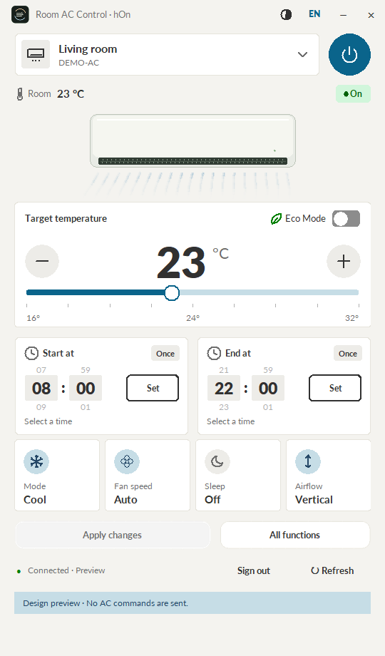

# Room AC Control for hOn

A Windows desktop controller for air conditioners connected to **hOn accounts**, including supported Haier units. Set your room temperature, switch modes, run comfort presets, and keep the latest AC status on your computer.

An independent community project powered by [pyhOn](https://github.com/Andre0512/pyhOn). It is not affiliated with, sponsored by or endorsed by Haier or hOn. Those names identify compatibility only; this project uses its own icon and generic appliance illustration.



## Start in one click

**Portable Windows release — Python is included.**

1. Download the Windows x64 ZIP from [Releases](https://github.com/LuisBadal0/room-ac-control-hon/releases/latest).
2. Extract the entire ZIP into a folder.
3. Double-click **Start Room AC Control.cmd** in the main folder.
4. Sign in with the same hOn email and password you use on your phone.

Keep the `runtime/` folder next to the launcher: it contains the application, Python, libraries, artwork and dependency notices. You can move the extracted folder to another location. Remembered accounts remain encrypted in your Windows profile.

**Running a source checkout:** install Python 3.11 or newer with Tkinter, then double-click the same launcher. First launch creates `.venv/` and installs dependencies there; internet access is needed for that setup. Python 3.13 is used for the portable build.

## What it does

- A dark dashboard with room temperature, target temperature, power, Eco, fan, Sleep and airflow controls.
- A room card showing the selected AC, with a themed **Switch** chooser for multiple units.
- Auto, Cool, Dry, Heat and Fan modes when supported by your AC. Cool Night and Heat Night use the unit's Sleep feature.
- All functions organized into **Settings**, **Everyday use** and **Maintenance**.
- Blue, amber or neutral animated airflow based on the AC's reported operating mode.
- Automatic status refresh through cloud events, with a periodic backup check.
- Independent last-used settings for each account, AC, mode, Night variant and native preset.
- Optional encrypted sign-in that reconnects automatically on later launches.
- An integrated window header; minimizing moves the app to the system tray.
- Inline **Start at / End at** time wheels below the temperature slider. One-time timers are saved to hOn's cloud, read back for confirmation, shown in green when active, and cancelled with **Stop** inside the card.

Selecting values stages changes. **Apply changes**, the power control, or explicitly starting a preset sends a command. **Set** saves a future cloud timer; **Stop** cancels it. Start at captures the selected mode and its remembered settings, including pending edits, without turning the AC on immediately. Status refresh and offline previews never send control commands.

Saved timers work with the computer switched off; the AC and router must remain powered and connected to the internet. Scheduling uses hOn's cloud service and does not claim that a timer is stored physically inside the AC. There is no PC scheduler or recurring-timer option. Multiple overlapping or unfamiliar schedules must be managed in hOn first. The community timer adapter was checked against hOn 2.30.7; future service changes may affect compatibility.

## Compatibility and privacy

Windows 10/11 x64, an hOn email/password account, and internet access on both the PC and AC are required. The AC must already be paired in the hOn phone app. Available features are discovered from each AC's cloud capabilities. This is cloud control, even if your PC and AC share a router.

Social-provider login is not supported. Features available only on a physical remote or absent from the cloud service's API cannot be exposed here. Cloud/network delays can affect when reported changes appear. Confirm refreshed status after a command timeout before retrying.

Remember me is off by default for new sign-ins. Enabling it saves your actual hOn email and password, encrypted with Windows DPAPI in `%LOCALAPPDATA%\RoomACControl\state.dpapi`. Programs running as your Windows user can decrypt them. Existing remembered accounts keep automatic sign-in; Sign out removes saved credentials. Your password is passed to the third-party pyhOn authentication library; session tokens stay in memory. No telemetry, local web server or router port forwarding is used. See [Security and privacy](SECURITY.md).

## Project layout

```text
Start Room AC Control.cmd     Main launcher for source and portable versions
src/room_ac_control/          Application code and runtime artwork
tools/                Setup, launch and build scripts
packaging/            Windows bundle recipe and build requirements
tests/                Offline regression and Windows UI checks
docs/                 User guide, preview and asset provenance
runtime/RoomACControl/       Generated executable and _internal/ dependencies
releases/             Generated portable ZIP
.venv/                Local development dependencies
```

Runtime builds, local environments, shortcuts and account files are excluded from Git. Publish portable ZIPs as release assets, rather than committing generated binaries.

## Develop and build

```powershell
.\tools\Setup.ps1
.\.venv\Scripts\python.exe -m room_ac_control --preview dashboard
.\.venv\Scripts\python.exe -m unittest discover -s tests -v
.\tools\Build.ps1
```

The preview uses fictional rooms and does not load saved credentials. Use `--preview login` to review the welcome screen. `tools/Build.ps1` produces `releases/Room-AC-Control-for-hOn-0.1.5-Windows-x64.zip` and a local app-icon shortcut. The build checks bundled assets, Windows encryption, tray imports and MQTT libraries without contacting an account.

Setup and build install full hash-verified Windows dependency locks. `Setup.ps1` prepares source execution; `Build.ps1` produces the portable executable. See [build verification](docs/BUILD_VERIFICATION.md) for checksums, source manifests, optional signing and CI attestations. Binaries remain unsigned until a valid signing certificate is supplied.

Windows UI checks: `tests/ui_smoke.py`, `tests/refresh_smoke.py`, `tests/desktop_smoke.py`, `tests/timer_smoke.py` (also run by ui_smoke), and `tests/window_header_smoke.py`. Active CI in `.github/workflows/windows.yml` pins actions to immutable commits, runs offline checks, and builds a portable Windows artifact for pull requests and pushes to main. Tagged releases are built and attested. Release tags should match the app version, such as `v0.1.5`.

See [Contributing](CONTRIBUTING.md) and the [user guide](docs/USER_GUIDE.md) for more detail.

## License and credits

Original application code and original artwork are licensed under [MIT](LICENSE). Dependencies retain their respective licenses; see [third-party notices](THIRD_PARTY_NOTICES.md). Portable builds include dependency license texts, and pystray is included as replaceable source files. Manufacturer logos and product photographs are excluded.

Built with [pyhOn](https://github.com/Andre0512/pyhOn), [Tkinter](https://docs.python.org/3/library/tkinter.html), [pystray](https://github.com/moses-palmer/pystray), [Pillow](https://python-pillow.org/), and the [AWS IoT SDK](https://github.com/aws/aws-iot-device-sdk-python-v2).
